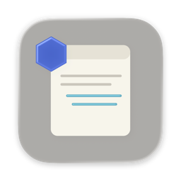
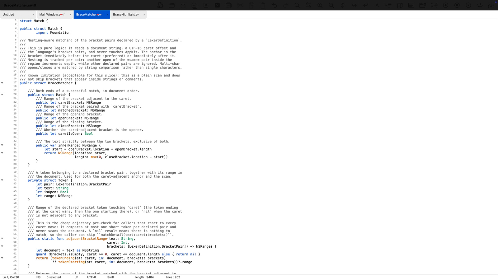
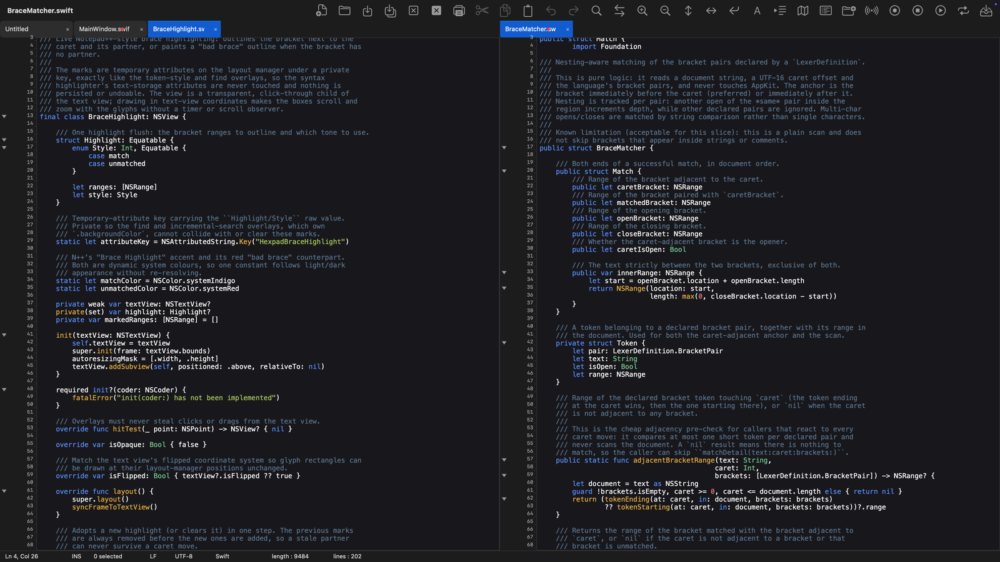

<p align="center">
  
</p>

<p align="center">
  
</p>

<p align="center">A fast and focused text and source code editor for macOS.</p>

I built Hexpad from scratch because Notepad++ doesn't have a native macOS version and I wasn't happy with the alternatives. Hexpad is that editor: Notepad++ features with real macOS behavior, free and open source.


## Install

Grab `Hexpad-1.0.0.dmg` from [Releases](https://github.com/cbertucci33/hexpad/releases), open it, and drag Hexpad to Applications. The app is signed and notarized, so Gatekeeper stays quiet.

Updates are automatic: Hexpad checks for new releases once a day and offers to update itself. You can also check manually from the app menu. Updates are verified with a signed key before anything is installed.

Requirements: macOS 14 or newer. Universal binary: Apple Silicon and Intel.

## What it does

*Brace matching* Put the caret next to a bracket, or select one, and both it and its partner outline in indigo. A bracket with no partner shows red, so you can see a broken clause while you edit. Works in every language with declared brackets: JSON, Swift, Python, the C family, shell, and more.

*Multiple selections and column editing* Place carets anywhere and type in all of them at once. Column (box) selection with the mouse or keyboard, Begin/End Select for rectangular regions, and per-caret editing that survives undo.

*Find in Files* Search the whole tree with include and exclude filters. Results group per file, fold and unfold, and every hit double-clicks to the exact line and column. Incremental search highlights as you type; large buffers get a debounced scan so typing stays smooth on files over a megabyte.

*Split view with two tab bars* Two panes side by side, each holding its own tabs. Move a file to the other view, transfer groups, drag tabs between panes, and synchronize scrolling when you're comparing two copies of a file.

*Syntax highlighting* across a long list of languages, driven by a lexer layer built for extension. Encoding detection on open, UTF-8/UTF-16 handling with BOM, and explicit encoding and line-ending conversion at save time.

*Function List and Document Map* Jump to the function you need in a large file, or use the minimap to see the whole document's shape while you scroll.

*Macros* Record a sequence of edits, play it back, run it a fixed number of times or until it stops changing the document, and save recordings to named slots in the menu.

*Session restore* Quit and reopen and your tabs come back with their scroll positions, carets, selections, and unsaved-state dots where you left them.

*Run menu* Pipe the current file or selection through external commands and capture the output, with `$(...)` placeholders for the document path and selection.



Everything is native AppKit: fast launch, no Electron, no web views. Also on board: bookmarks, blank and line operations, date/time insertion with configurable formats, character panel, document summary with exact counts, read-only mode, keybinding remapping with a full shortcut mapper, and file monitoring that picks up external changes live.



## Building from source

```sh
git clone https://github.com/cbertucci33/hexpad.git
cd hexpad
xcodegen generate
open Hexpad.xcodeproj
```

Then build the Hexpad scheme in Xcode. The core (parsing, brace matching, sessions, encodings) lives in the `HexpadKit` package target and has its own test suite; the app target carries the AppKit-layer tests.

## License

[MIT](LICENSE)
