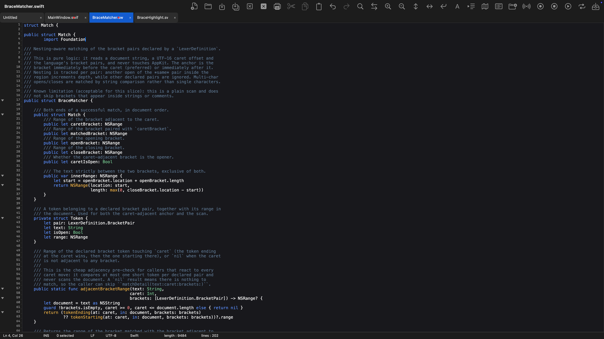

# Hexpad

A fast and focused text and source code editor for macOS.

I built Hexpad because Notepad++ doesn't have a native macOS version and I wasn't happy with the alternatives. Hexpad is that editor: Notepad++'s feature set, real macOS behavior, free and open source.



## Highlights

**Brace matching.** Put the caret next to a bracket, or select one, and both it and its partner light up. If a bracket has no partner, it shows in red so you can see the broken clause while you edit. Works in every language with defined brackets: JSON, Swift, Python, C family, shell, and more.

**Real multi-editing.** Multiple selections and column (box) editing, with Begin/End Select for column-mode selection like Notepad++. Find and replace across the document, all open documents, or the whole file tree with include/exclude filters.

**Split view and tabs.** Two panes, each with its own tab bar. Drag tabs between panes, move a file to the other view, or transfer groups. Double-click empty tab-bar space for a new tab. Overflow tabs get chevron navigation.

**Syntax highlighting** for a long list of languages, with the lexer layer built for extension. Encoding detection on open, including BOM handling and explicit encoding/EOL conversion with save-time conversion queuing.


## Notepad++ features, macOS behavior

Hexpad ports the Notepad++ workflow you know:

- **Find in Files** with per-file result groups you can fold, double-click to jump to the hit
- **Function List** panel for jumping around large files
- **Document Map** (minimap) with synchronized scrolling
- **Folder as Workspace** for browsing a directory tree as files
- **File monitoring** (tail -f): the editor picks up external changes live
- **Macros**: record, play, run multiple times with an until-end-of-file option, save to named slots
- **Run menu**: pipe the current file or selection through external commands
- **Session snapshot and restore**: your tabs come back the way you left them
- **Document summary** dialog with exact character/byte/line/word counts
- **Bookmarks**, blank operations, line operations, date/time insertion
- **Keybindings**: rebind any command, reset to defaults, full shortcut mapper

All of it native AppKit: fast launch, no Electron, no web views.

## Split view


## Install

Grab `Hexpad-1.0.0.dmg` from [Releases](https://github.com/cbertucci33/hexpad/releases), open it, and drag Hexpad to Applications. The app is signed and notarized, so Gatekeeper stays quiet.

Requirements: macOS 14 or newer. Universal binary: Apple Silicon and Intel.

## Building from source

```sh
git clone https://github.com/cbertucci33/hexpad.git
cd hexpad
xcodegen generate
open Hexpad.xcodeproj
```

Then build the Hexpad scheme in Xcode. The core (parsing, brace matching, sessions, encodings) lives in the `HexpadKit` package target and has its own test suite; the app target carries the AppKit-layer tests.

## License

[MIT](LICENSE)
